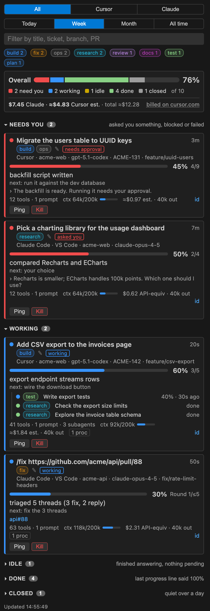
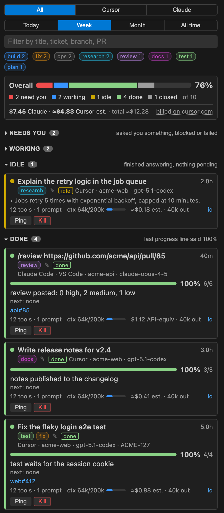

# Agent Tracker

Agent Tracker is a sidebar for Cursor and VS Code that lists every Cursor and Claude Code agent on your computer. It shows how far along each agent is and whether it's waiting on you.

<table>
  <tr>
    <td width="50%"></td>
    <td width="50%"></td>
  </tr>
</table>

<sub>The screenshots use mock data from <code>preview/mock-snapshot.js</code>.</sub>

## Install

### 1. Install the extension

Download it, then run the install line for each editor you use:

```bash
curl -LO https://github.com/felyppers/agent-tracker/releases/latest/download/agent-tracker.vsix
cursor --install-extension agent-tracker.vsix   # Cursor
code --install-extension agent-tracker.vsix     # VS Code
```

On Windows PowerShell, type `curl.exe`. Or download the file from the [releases page](https://github.com/felyppers/agent-tracker/releases/latest) and run "Extensions: Install from VSIX..." from the command palette (<kbd>Cmd</kbd>+<kbd>Shift</kbd>+<kbd>P</kbd> on macOS, <kbd>Ctrl</kbd>+<kbd>Shift</kbd>+<kbd>P</kbd> on Linux and Windows).

### 2. Install the progress rules

> [!IMPORTANT]
> Don't skip this step. Agents only report progress when told to, so without it the progress bars stay empty.

Reload the window and open the command palette: <kbd>Cmd</kbd>+<kbd>Shift</kbd>+<kbd>P</kbd> on macOS, <kbd>Ctrl</kbd>+<kbd>Shift</kbd>+<kbd>P</kbd> on Linux and Windows. Then run:

```
Agent Tracker: Install Progress Rules
```

It installs a `progress-tracking` skill for Claude Code and Cursor, plus an always-on rule, so every agent prints lines like `**[60%]** 3/5 — tests pass · next: open the PR`. New chats pick it up; open ones don't.

### 3. Optional: live Cursor status

Agent Tracker reads Cursor's chat database with `sqlite3`. macOS has it. On Linux run `sudo apt install sqlite3`, and on Windows `winget install SQLite.SQLite`. Without it, Cursor chats show up only after Cursor writes their transcript.

## What it shows

Agents are grouped by what they need from you. Needs you comes first: agents waiting on an approval or an answer (their own or one of their subagents'), and agents that stalled or failed. Working comes next. Finished agents go to Idle or Done, and anything quiet for a day goes to Closed.

Each card has a progress bar with the agent's last step. Below it are the agent's subagents, PRs and cost. Click the title to open the chat. Ping nudges an agent to continue. Kill stops it after asking you first. When a task is killed or done, Agent Tracker removes the git worktrees it left behind, unless a worktree has changes that aren't pushed.

The top of the sidebar shows the average progress and the total cost of all agents. Each chat gets labels such as build or review from its first prompt, and you can change them with ✎.

## Settings

Search for `agentTracker` in your editor settings. Most people only touch the ping text and the worktree cleanup.

## How it works

It reads files that Cursor and Claude Code already keep on your machine, and sends nothing anywhere. Claude Code costs come from its token counts. Cursor doesn't store token counts, so Cursor costs are estimates and your real bill is on cursor.com. Cursor also saves message text about 30 seconds late, so Cursor progress lags by that much. The commands it uses to open and cancel Cursor chats aren't public, so a Cursor update could break them.

Transcripts live in `~/.cursor` and `~/.claude` on every system. Cursor's live chat data is in its `globalStorage/state.vscdb`, which is under `~/Library/Application Support/Cursor/User` on macOS, `~/.config/Cursor/User` on Linux, and `%APPDATA%\Cursor\User` on Windows. Without `sqlite3`, Cursor chats still show up, but only once Cursor writes their transcript.

To match processes to chats, Agent Tracker reads each process's environment, where Cursor leaves the chat's id. Windows doesn't let one process read another's environment, so on Windows Kill cancels a Cursor chat but can't stop the shells it started. Claude Code sessions can be stopped on every system.

It's used daily on macOS, and the Linux code was tested in a container. Windows hasn't been tested yet, so please [open an issue](https://github.com/felyppers/agent-tracker/issues) if something breaks there.

## Development

There's no build step. The extension is plain JavaScript in `src/`, and the sidebar is in `media/`. To install from source you need `git` and Node.js 18 or later:

```bash
git clone https://github.com/felyppers/agent-tracker.git
cd agent-tracker
npx --yes @vscode/vsce package
cursor --install-extension agent-tracker-*.vsix
node scripts/install-progress-rules.js           # add --bridge for the Cursor bridge hook
```

To work on the sidebar without real data:

```bash
python3 -m http.server 8765    # then open http://localhost:8765/preview/index.html?data=mock
node bin/snapshot.js --brief   # your real sessions, in the terminal
```

## License

[MIT](LICENSE)
